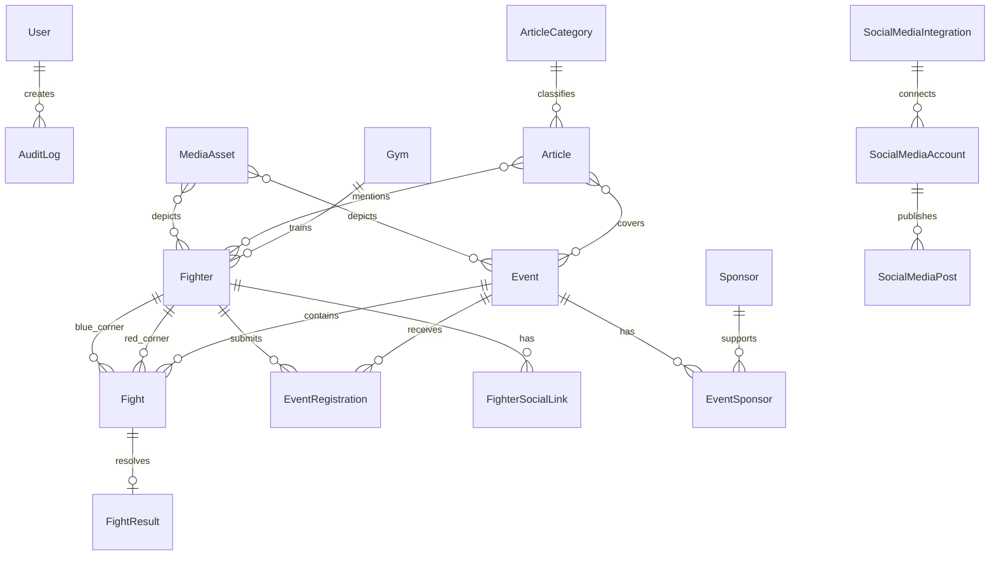

# Database ERD

The executable model is `prisma/schema.prisma`. `id` is the stable primary key, slugs are unique for public URLs, relationships use foreign keys, and lifecycle tables have timestamps. Fighter records derive from approved `FightResult` rows; imported records require source attribution and an explicit verified flag.

Private application records are separated from `Fighter`; approval never automatically publishes registration fields. The schema includes indexes on status/date and foreign keys. Audit data records editor actions but must never store passwords or tokens.
